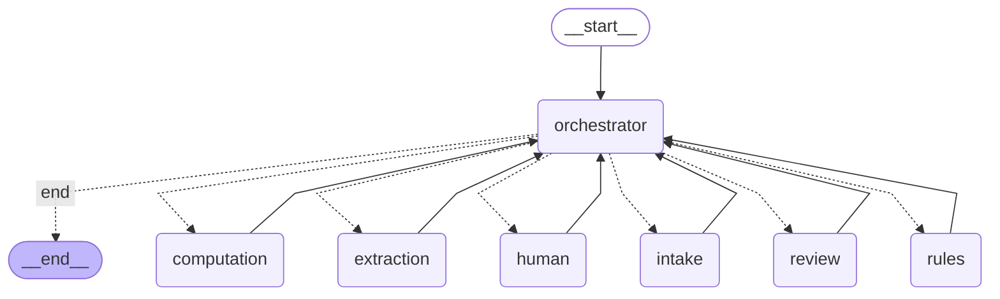

# SilverFile (multiagent-tax-system)

A multi-agent system, built in LangGraph (Python), that helps prepare a **draft** US Form 1040-SR for
seniors. It never files anything, never gives tax advice, never states an unsourced dollar amount,
sends defined cases to a human, and handles only the in-scope return profile. Test data only: no real
SSNs.

## Teammates start here
If you own an agent, read [docs/handoff-contract.md](docs/handoff-contract.md) first: what state you may
read and write, the handoff format, how to escalate to a human, and how to replace your stub.
Project status: [docs/STATUS.md](docs/STATUS.md).

## Run with Docker
No local Python needed. The image is built and checked in CI on every push.

```
docker build -t silverfile .
docker run --rm silverfile                                    # a clean case to "DRAFT READY"
docker run --rm silverfile pytest -q                          # all tests, inside the container
docker run --rm -p 8501:8501 silverfile streamlit run src/ui/taxpayer_chat.py
                                                              # taxpayer chat page: http://localhost:8501
```

Secrets are never built into the image. Docker's `--env-file .env` sets environment variables, but the P3 W-2 page reads the `.env` file directly. To use that page in Docker, also mount your local `.env` file read-only at the project root inside the container, alongside `app.py`. Never copy secrets into the image.

## How it works
Six agents, one hub. The **orchestrator** is the only thing that chooses the next hop and decides when to
stop; it does not extract, compute, or talk to the user. The other five (Intake, Document Extraction,
Eligibility & Rules, Computation, Review/Audit) never call each other: each returns a state update plus
a handoff request, which the orchestrator validates. Every agent call goes through one wrapper
(`src/orchestration/runner.py`) that scopes what the agent can see, enforces its read/write/tool
allow-lists, and writes a JSONL trace to `traces/`.

What the graph demonstrates:
- **Conditional routing:** the next hop is a pure function of state (`src/orchestration/router.py`).
- **Parallel branch:** extraction fans out one worker per document and merges with an order-independent reducer.
- **Bounded cycle:** Review sends work back to Computation, at most 3 times by default.
- **Loop guard:** a pathological handoff loop escalates to a human.
- **Human in the loop:** a LangGraph interrupt for out-of-scope items, unresolved conflicts, 1099-R box 2b,
  tax-advice requests, filing-status ambiguity (such as a spouse who died), and signs of exploitation.
- **Context management:** each agent gets the smallest view it needs
  ([decision record](docs/decisions/001-context-strategy.md), [measurements](docs/metrics.md)).

<!-- graph:start -->

<!-- graph:end -->

*Generated from the compiled graph by `python -m scripts.draw_graph`; every agent returns to the orchestrator
(solid), and only the orchestrator chooses the next hop (dotted).*

## Run it
Python 3.11 or newer (CI tests 3.11).

```
python3.11 -m venv .venv
.venv/bin/pip install -r requirements.txt
.venv/bin/pytest                                              # all tests, offline and fast
```

Scenarios (all offline; each writes a trace to `traces/`):

```
.venv/bin/python -m scripts.run_scenarios clean               # a clean case to "DRAFT READY"
.venv/bin/python -m scripts.run_scenarios interrupt           # pauses for a human, then resumes
.venv/bin/python -m scripts.run_scenarios spouse-died         # filing-status ambiguity, volunteer supplies the status
.venv/bin/python -m scripts.run_scenarios clean --no-context-strategy   # every agent gets the full state
.venv/bin/python -m scripts.measure_context                   # regenerates docs/metrics.md
.venv/bin/python -m scripts.draw_graph                        # regenerates the diagram above
```

A trace line (`traces/<thread_id>.jsonl`) records the agent, the handoff (from, to, reason), the state
fields read and written, duration, and estimated input/output tokens. It stores field names, never values.

## Layout
| Path | What |
|---|---|
| `src/state.py` | The shared state contract (fields, reducers, escalation conditions) |
| `src/graph.py` | The hub-and-spoke graph |
| `src/orchestration/` | Router, orchestrator, loop guard, human gate, runner/tracing, access policy, context views |
| `src/agents/` | The five agents (some are still stubs) |
| `tests/` | Tests, including the decision table and `test_merge_order.py` |
| `docs/` | [Contract](docs/handoff-contract.md), [decision record](docs/decisions/001-context-strategy.md), [metrics](docs/metrics.md), [Intake/Rules fact names](docs/intake-rules-contract.md), [status](docs/STATUS.md) |

## Rules for contributors
Feature branches and pull requests; nothing goes straight to `main`. Run `pytest` before every commit.
Secrets live only in `.env` (see `.env.example`); never commit it or traces containing personal data.

## Eval cases
End-to-end cases (a clean return, the spouse-died case, each escalation) are in [evals/cases.json](evals/cases.json); how to read and add them: [evals/README.md](evals/README.md). Eval case 1 (clean run) and eval case 2 (HITL, resolved): [demo/eval_case_1.md](demo/eval_case_1.md), [demo/eval_case_2.md](demo/eval_case_2.md).

```
python -m evals.runner                       # PASS / FAIL / PENDING for every case
docker run --rm silverfile python -m evals.runner
```

## P3 document extraction workbench
This folder combines the team files supplied in this conversation with P3's W-2 extraction and memory implementation. It is an integration candidate, not a completed six-agent tax product. **The supplied Intake, Computation and Review agents still contain stubs.** A `complete` graph status does not mean a valid return has been prepared.

## Windows / VS Code

1. Extract into a **new folder**, leaving your existing team checkout untouched.
2. Open the folder containing `start.py` in VS Code.
3. Before starting the app, copy `.env.example` to `.env` in the project root. Enter your own `OPENAI_API_KEY` or `ANTHROPIC_API_KEY`, leave unused keys blank, and save. Never commit `.env`. Open Terminal → New Terminal and run:

```powershell
python start.py
```

Python 3.11+ is required. The launcher installs dependencies into this folder's `.venv`. No Tesseract, Docker, activation command or source-code editing is required.

4. Open http://127.0.0.1:8501.
5. Select OpenAI or Anthropic in the sidebar, matching the key configured in `.env`. Choose a new case ID. Graders should configure their own API keys in `.env`.
6. Upload `data/fixtures/w2_01.jpg`, confirm fictional data and click **Read W-2 image**.
7. Compare the amounts, fill in the reviewer/note, confirm visual verification and save the review.
8. Restart with the same case ID to inspect persisted results.

The workbench uses the **team graph**, access policies, parallel extraction node, runner and human gate. For this P3 demo only, it supplies fictional age 70 / Single facts and skips Intake. It accepts one new W-2 per case; the underlying team graph supports multiple document workers. Use a new ID for another image.

## What was connected

- `src/agents/extraction.py` calls a registered P3 tool, rather than returning a hard-coded amount.
- W-2 images are sent to the selected provider: OpenAI or Anthropic. Deterministic synthetic text fixtures are used for offline tests.
- The result uses `extracted[doc_id].fields.box_1` etc., with the team's five provenance fields. Shared field values are numeric; internal extraction records preserve decimal strings and source evidence.
- The Orchestrator sends `EXTRACTION_REVIEW` to its human gate. Each document must be approved separately. Corrections update the extracted record and preserve the original.
- The runner records actual provider token usage for image extraction, keeping estimates labelled for other agents.
- The demo supplies SQLite persistence to the team's graph. P2 can use `src.memory` for checkpointer factories, answer storage and a read-only resume summary.

## Privacy and operational limits

Use **fictional test documents only**. The whole image is normalized and saved locally after your confirmation, then sent to the selected provider, OpenAI or Anthropic. This version retains the confirmed upload to allow retry/restart. Model-based SSN screening occurs after transmission; it is not reliable redaction or a guarantee that all real identifiers are blocked. This differs from the old standalone service, which saved only after model validation. Never upload real tax documents.

API keys are read from the local `.env` file; the sidebar does not accept API keys. Keys remain in that local file and are not placed in graph state, traces or exported records. Never commit `.env`; only share `.env.example` with blank API-key values.

Calls may incur charges on the selected provider account. OpenAI requests use `store=False`; this does not guarantee zero provider retention and is not an Anthropic setting. Case IDs are not authentication. Keep this classroom UI on localhost.

Runtime images, databases and traces are under `runtime/` and ignored by Git. Do not commit `.env`, keys, `.venv` or runtime data. This ZIP contains no API key and does not migrate old checkpoints.

## Validate before merging

```powershell
.\.venv\Scripts\python.exe -m pytest -q
```

For the P3-only unit suite:

```powershell
.\.venv\Scripts\python.exe -m unittest discover -s tests_p3 -v
```

See [P3_INTEGRATION.md](docs/P3_INTEGRATION.md), [P3_CHANGED_FILES.md](docs/P3_CHANGED_FILES.md) and [VALIDATION.md](docs/VALIDATION.md). The common graph/security-policy/human-gate changes must be reviewed by P1 before merging into the team branch. 
